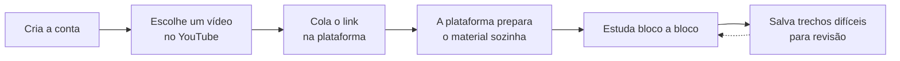
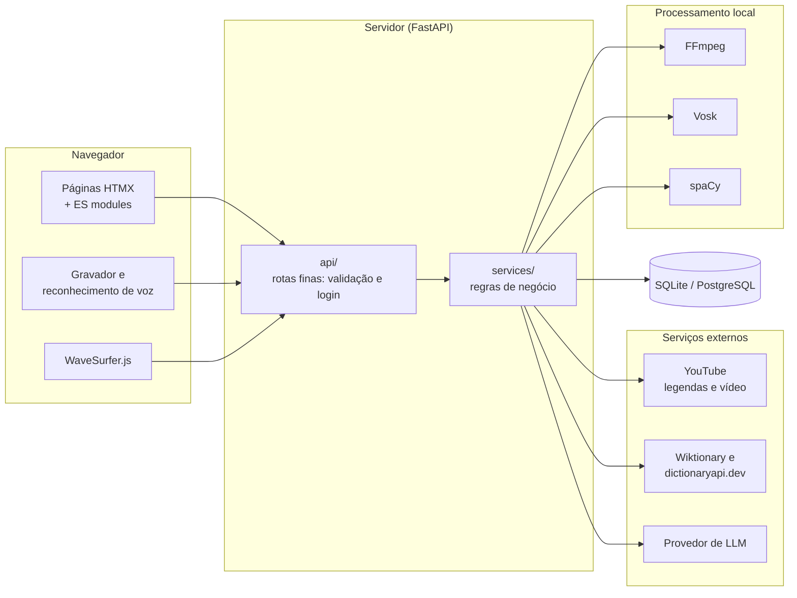
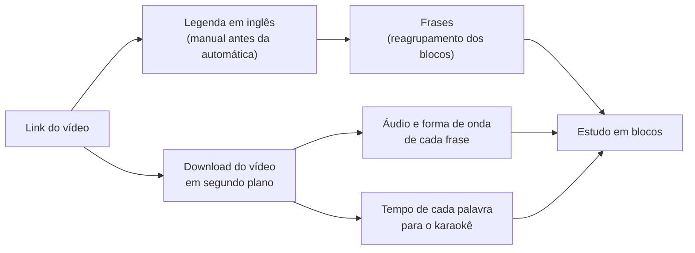
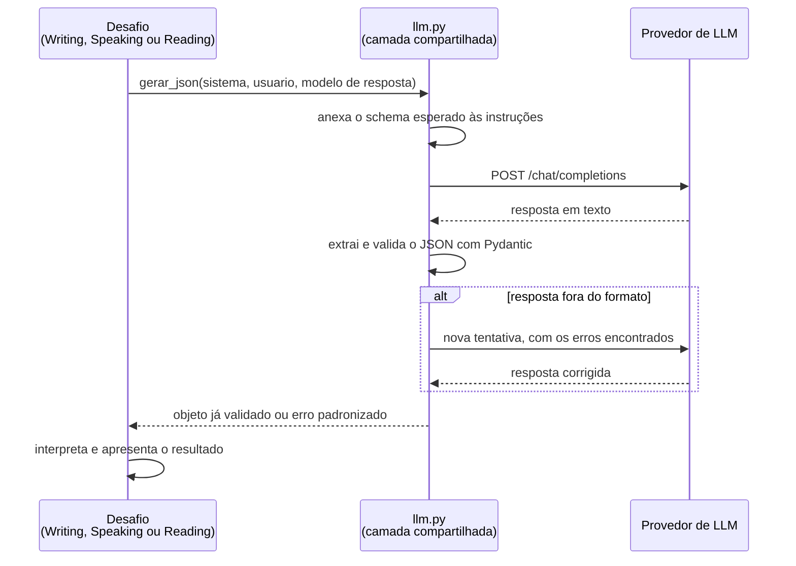

# Shadowing

**Plataforma para praticar inglês com vídeos do YouTube escolhidos pelo próprio estudante.**

O estudante cola o link de um vídeo, e a plataforma prepara automaticamente o material de estudo: divide a fala em
blocos curtos, sincroniza a legenda, permite gravar a própria voz e compará-la ao ritmo original, salva trechos para
revisão espaçada e explica o vocabulário com significado e pronúncia.

| | |
|---|---|
| **Meu papel** | Idealizador do produto e Tech Lead |
| **Stack** | Python · FastAPI · SQLModel · PostgreSQL/SQLite · Alembic · HTMX · JavaScript (ES modules) |
| **Situação** | Plataforma principal funcional e testada com usuários externos à equipe · expansão com IA em desenvolvimento · ainda sem lançamento público |
| **Reconhecimento** | Vencedor do prêmio PIPA (IME-USP) · R$ 6.500 para continuidade do projeto |
| **Código** | [Projeto-ShadowingYoutube/Projeto, branch `Membro4`](https://github.com/Projeto-ShadowingYoutube/Projeto/tree/Membro4) |

> Este repositório é um **estudo de caso**: apresenta o produto, as decisões técnicas e a minha contribuição. Ele não
> contém o código-fonte, que está no repositório da organização. Ao longo do texto, deixo claro o que está
> **confirmado no código**, o que é **informação da equipe** e o que ainda está **planejado**
> (veja [Fontes das informações](#fontes-das-informações)).

---

## Sumário

- [Demonstração](#demonstração)
- [O problema](#o-problema)
- [A solução](#a-solução)
- [Funcionalidades](#funcionalidades)
- [Minha atuação](#minha-atuação)
- [Arquitetura técnica](#arquitetura-técnica)
- [Arquitetura de IA](#arquitetura-de-ia)
- [Expansão: desafios com IA](#expansão-desafios-com-ia)
- [Reconhecimento](#reconhecimento)
- [Estado atual](#estado-atual)
- [Roadmap](#roadmap)
- [Créditos](#créditos)
- [Fontes das informações](#fontes-das-informações)

---

## Demonstração

**Vídeo de demonstração:**

O vídeo percorre a plataforma em funcionamento:

- interface inicial e criação de conta;
- inserção do link de um vídeo do YouTube e geração automática do material;
- estudo em blocos, com controles de legenda e áudio;
- gravação da própria voz e indicador de ritmo;
- salvamento de trechos e revisão espaçada;
- consulta de vocabulário, guia fonético e pronúncia.

**Código-fonte:** o projeto atual está na branch
[`Membro4`](https://github.com/Projeto-ShadowingYoutube/Projeto/tree/Membro4) do repositório da organização. A branch
`main` contém apenas uma versão anterior da plataforma.

---

## O problema

*Shadowing* é uma técnica de prática oral em que o estudante ouve um trecho de fala nativa e o repete logo em
seguida, imitando pronúncia, ritmo e entonação. Funciona melhor com trechos curtos e conteúdo que o estudante tem
interesse em ouvir.

Na prática, preparar esse material dá trabalho: escolher o vídeo, encontrar a legenda, cortar o áudio em frases,
repetir cada trecho, gravar a própria voz para comparar e anotar as palavras desconhecidas. Cada etapa costuma exigir
uma ferramenta diferente. O resultado é que o estudante acaba limitado a materiais prontos, que nem sempre
correspondem ao que ele quer assistir.

## A solução

O Shadowing reúne essas etapas numa única plataforma e automatiza a preparação do material.

O estudante não precisa cortar o vídeo nem montar os blocos de estudo: a partir do link, o sistema busca a legenda em
inglês, divide a fala em frases curtas e prepara o vídeo, o áudio e os tempos de cada trecho.

---

## Funcionalidades

Funcionalidades da plataforma principal, todas **confirmadas no código**.

**Prática de shadowing**
- Conteúdo organizado em blocos: a legenda do YouTube é reagrupada em frases de duração adequada à repetição.
- Legenda que pode ser ocultada ou exibida, para treinar a escuta sem apoio do texto.
- Gravação da própria voz para comparar com o trecho original.
- Indicador de ritmo: mostra se a fala ficou no ritmo do original ou quanto ficou mais rápida ou mais lenta.
- Controle de velocidade da reprodução (0,25x a 1,5x), salvo nas preferências da conta.

**Revisão espaçada**
- Trechos de estudo salvos como cartões, organizados em decks.
- Cada cartão volta para revisão num intervalo que cresce a cada revisão feita, de acordo com a dificuldade marcada.
- Os trechos difíceis podem ser revisitados a partir do próprio deck.

**Vocabulário**
- Seleção de qualquer palavra da legenda.
- Significado da palavra, considerando a forma base e a classe gramatical no contexto da frase.
- Guia fonético (IPA) e reprodução da pronúncia, quando disponíveis na fonte consultada.

**Experiência**
- Interface simples, com fluxo automatizado a partir do link do vídeo.
- Conteúdo escolhido pelo próprio estudante.
- Prática, revisão e vocabulário integrados na mesma plataforma, com conta individual e dados isolados por usuário.

---

## Minha atuação

Fui o **idealizador do Shadowing** e atuei como **Tech Lead** da equipe. A implementação das funcionalidades foi um
trabalho coletivo. Abaixo está o que foi de minha responsabilidade.

### Produto
- Concebi a proposta original do Shadowing e defini a experiência principal de aprendizagem.
- Estruturei o funcionamento geral do produto: do link do vídeo ao estudo em blocos e à revisão.
- Idealizei a interface e defini o layout em conjunto com outro integrante da equipe.
- Planejei a expansão da plataforma para os desafios com IA.

### Liderança técnica
- Defini as tecnologias utilizadas e projetei a arquitetura inicial.
- Desenvolvi a estrutura-base da aplicação.
- Organizei a divisão de responsabilidades, planejei as sprints e coordenei as decisões técnicas para manter a
  consistência do projeto.

**Arquitetura para desenvolvimento paralelo.** Defini a estratégia para que os três desafios fossem desenvolvidos ao
mesmo tempo, por integrantes diferentes, sem interferir na base nem uns nos outros:

- **Uma branch por desafio**, criada a partir de uma base comum e integrada ao final.
- **Arquivos protegidos:** os arquivos centrais (serviços, rotas, modelos, migrações existentes e a camada de LLM) não
  são alterados pelos desafios. Um teste automatizado compara o hash dos mais críticos e falha se algum deles mudar.
- **Pontos de integração:** cada integrante tem um bloco reservado nos poucos arquivos que precisa tocar (registro de
  rotas, modelos, CSS, JavaScript, dependências), o que evita conflitos no merge.
- **Faixas de migração por integrante** (`0101…`, `0201…`, `0301…`), para que três frentes criem tabelas em paralelo
  sem colisão de versões do banco.

**Desenvolvimento assistido por IA.** Criei e estruturei o `CLAUDE.md`, os guias técnicos de cada desafio e os
prompts de início de sessão usados pelos integrantes, delimitando como cada um trabalha com o Claude Code:

- **Contexto obrigatório:** a cada sessão, a IA identifica o integrante, lê as regras, o guia do desafio e a
  documentação da base e confere a branch e o estado do Git antes de qualquer ação.
- **Processo em fases:** auditoria da base, planejamento em blocos e execução de um bloco por vez, com explicação
  antes de programar e aprovação do integrante a cada etapa.
- **Limites de atuação:** a IA não altera arquivos protegidos sem justificar a necessidade, propor a menor mudança
  possível e obter confirmação explícita; não troca de branch e não faz commits, que ficam com o integrante.
- **Critérios de validação:** um bloco só é concluído depois de rodar a suíte inteira, revisar o diff em busca de
  alterações em arquivos protegidos e demonstrar, quebrando o código de propósito, que os testes detectam a falha.

Estabeleci os requisitos e orientei a implementação desses mecanismos de proteção e validação.

### Arquitetura de IA
- Projetei e implementei a **camada compartilhada de integração com LLMs** (`app/services/llm.py`), descrita em
  [Arquitetura de IA](#arquitetura-de-ia).
- A implementação de cada um dos três desafios está sendo feita por outros integrantes da equipe, sobre essa camada.

---

## Arquitetura técnica

Informações **confirmadas no código** da branch `Membro4` (commit `49636dd`, 10/11/2026).

### Tecnologias

| Camada | Tecnologias |
|---|---|
| Backend | Python, FastAPI, Uvicorn, Pydantic, pydantic-settings |
| Frontend | Templates Jinja2, HTMX, JavaScript em ES modules, WaveSurfer.js |
| Banco de dados | SQLModel (SQLAlchemy), Alembic; SQLite no desenvolvimento local e PostgreSQL (via Docker Compose) como banco de destino |
| Conteúdo do YouTube | youtube-transcript-api (legendas), yt-dlp (vídeo), FFmpeg (corte do áudio por frase) |
| Processamento de fala e áudio | MediaRecorder e reconhecimento de voz do navegador (Chrome/Edge), Vosk (alinhamento áudio–texto), NumPy (forma de onda) |
| Linguagem | spaCy com `en_core_web_sm` (forma base e classe gramatical), Wiktionary (definições), dictionaryapi.dev (IPA e áudio) |
| Segurança | Argon2id, sessão no servidor com cookie HttpOnly, verificação de Origin (CSRF), limites de uso com `limits` |
| Qualidade | pytest, pytest-cov, Ruff, Playwright (testes de navegador opcionais) |

### Componentes

O backend separa **rotas** (`app/api/`), que só validam a entrada, verificam a sessão e chamam os serviços, de **serviços**
(`app/services/`), que concentram as regras de negócio sem depender do FastAPI e podem ser testados isoladamente.

### Geração automática do material

- **Legenda:** a plataforma prefere a legenda manual em qualquer variante de inglês (`en`, `en-US`, `en-GB`…) e usa a
  automática quando não há manual. O estudante é avisado quando a legenda é automática, porque ela pode conter erros.
- **Frases:** os blocos de legenda do YouTube são cortados pela largura da tela, não pelo sentido. O serviço de frases
  os reagrupa por pontuação ou pausa na fala e ajusta a duração (junta trechos curtos demais e quebra os longos).
- **Mídia:** o vídeo é baixado em segundo plano. O áudio de cada frase é recortado com FFmpeg, e a forma de onda é
  calculada uma vez no servidor e guardada no banco.
- **Tempo das palavras:** vem da legenda automática do YouTube ou do alinhamento com Vosk e destaca a palavra falada
  durante a reprodução.

### Decisões técnicas

| Decisão | Motivo |
|---|---|
| Forma de onda calculada no servidor (400 valores em JSON) e guardada no banco | O navegador baixava o WAV de cada frase (~88 KB por segundo); agora recebe ~3 KB e reaproveita o cálculo nas visitas seguintes |
| Limite de vídeos novos por conta (5 a cada 5 minutos), com resposta 429 e `Retry-After` | Muitas consultas seguidas levam o YouTube a bloquear o servidor; o limite é por conta, não por IP |
| Banco versionado com Alembic e comando próprio de migração com backup automático (SQLite) | O app confere a versão do banco ao iniciar, mas não migra sozinho: migração pode ser destrutiva e não deve rodar escondida |
| Sessão no servidor: token aleatório em cookie HttpOnly e apenas o hash SHA-256 no banco | Permite logout real (revogação da sessão) e não expõe o token |
| Recurso de outra conta responde 404, e não 403 | Um 403 confirmaria que o ID existe (falha do tipo IDOR) |
| Formato único de erro na API (`{detail, codigo}`) | A interface mostra `detail` e decide o que fazer pelo `codigo`, que é estável |
| API fechada por padrão: sem sessão, as rotas `/api` respondem 401, exceto as de cadastro, login e logout | Um teste percorre todas as rotas registradas e falha se uma rota nova responder sem login, a menos que ela seja declarada pública de propósito |

**Rotas públicas e protegidas.** Sem sessão, só respondem as rotas de cadastro, login e logout
(`/api/auth/cadastro`, `/api/auth/login`, `/api/auth/logout`). A rota `/api/auth/me` e todas as demais rotas da API,
incluindo vídeo, legendas, forma de onda, avaliação da fala, dicionário, decks e LLM, exigem login. Entre as páginas,
só `/login` e `/cadastro` são abertas; as outras redirecionam para o login. Os arquivos estáticos (`/static`) e a
documentação automática da API (`/docs`) também são públicos.

### Testes

A suíte automatizada da branch `Membro4` foi executada em 16/11/2026, com SQLite: **266 testes aprovados e 2
ignorados**. Os ignorados são opcionais e dependem de configuração própria: a suíte de testes de navegador
(Playwright) e o teste exclusivo de PostgreSQL. Os testes cobrem, entre outros
pontos, autenticação, isolamento entre contas, proteção contra CSRF, limites de uso, migrações, legendas, forma de
onda e a camada de LLM com um provedor simulado.

---

## Arquitetura de IA

### O problema que a camada resolve

A expansão prevê três desafios que usam LLMs: Writing, Speaking e Reading. Se cada um integrasse um provedor por conta
própria, haveria três formas de montar requisições, tratar erros, validar respostas e configurar chaves. Trocar de
modelo exigiria mudar três partes do código.

### Solução: um serviço único de LLM

Projetei e implementei uma **camada compartilhada** que centraliza a comunicação entre os desafios e o provedor de
modelos de linguagem. O módulo está publicado na branch `Membro4`:
[`app/services/llm.py`](https://github.com/Projeto-ShadowingYoutube/Projeto/blob/Membro4/app/services/llm.py).

1. **Contrato padronizado de entrada.** Cada desafio envia as instruções (`sistema`), o conteúdo a processar
   (`usuario`) e um modelo Pydantic que descreve a resposta esperada. Os prompts ficam no serviço de cada desafio; a
   camada não conhece nenhum deles.
2. **Adaptação ao provedor.** A camada monta a requisição no formato de API compatível com a OpenAI, adotado por
   vários provedores. Endereço, modelo e chave vêm da configuração do ambiente.
3. **Processamento pelo modelo.**
4. **Normalização da resposta.** O JSON é extraído (tolerando blocos de código e texto extra) e validado contra o
   schema. Se vier fora do formato, há **uma** nova tentativa, mostrando ao modelo os erros encontrados. Timeouts e
   falhas de rede não são repetidos.
5. **Uso pelo desafio.** O desafio recebe um objeto tipado e já validado, ou uma exceção padronizada.

**Erros padronizados.** Toda falha vira uma exceção própria, convertida no formato de erro da API: IA não configurada
(503), provedor indisponível ou chave recusada (502), tempo esgotado (504) e resposta inválida após a nova tentativa
(502). Sem chave configurada, a aplicação sobe normalmente e apenas as funções de IA ficam indisponíveis. A chave
nunca aparece em logs nem em mensagens de erro.

### Componentes de apoio da camada

- **Cota diária por conta:** cada conta pode iniciar 10 desafios por dia em cada atividade, aplicada apenas na rota
  que cria o desafio ([`app/api/llm.py`](https://github.com/Projeto-ShadowingYoutube/Projeto/blob/Membro4/app/api/llm.py)).
  É o primeiro controle de custo operacional da IA.
- **Aviso de privacidade:** antes do envio, a interface informa que o texto ou a transcrição da fala será processado
  por um provedor externo de IA.
- **Provedor simulado nos testes:** os testes nunca chamam a LLM real. Uma fixture reprova qualquer tentativa e outra
  simula respostas, passando pela mesma validação usada em produção
  ([`tests/test_llm.py`](https://github.com/Projeto-ShadowingYoutube/Projeto/blob/Membro4/tests/test_llm.py)).

### Benefícios do desenho

- Nenhum desafio integra um provedor de LLM de forma independente.
- Entrada e saída seguem o mesmo contrato, com respostas sempre validadas.
- Os desafios ficam desacoplados do provedor: trocar de modelo é uma mudança de configuração, não de código.
- Tratamento de erro, limites e privacidade ficam num único lugar, o que facilita a manutenção e a evolução.

### Situação da validação

| Item | Situação |
|---|---|
| Estrutura da camada, erros padronizados, nova tentativa e cota | Implementados e cobertos por testes automatizados com provedor simulado |
| Funcionamento de ponta a ponta com respostas reais de um provedor | **Pendente de confirmação** |
| Uso pelos três desafios | Em desenvolvimento, junto com os desafios |

---

## Expansão: desafios com IA

> **Em desenvolvimento.** Os três desafios ainda não foram lançados. A previsão atual de conclusão é
> **28 de novembro de 2026**.

A expansão leva a plataforma, que hoje se concentra em escuta e pronúncia, para outras habilidades do inglês. Os três
desafios usam a camada compartilhada de LLM e estão sendo implementados por outros integrantes da equipe, cada um na
própria branch.

| Desafio | Como funciona | Papel da IA |
|---|---|---|
| **Writing Challenge** | O sistema propõe um tema de redação, e o estudante escreve o texto | Avaliação automatizada da redação |
| **Speaking Challenge** | Perguntas em formato de entrevista simulada, com tempo limite para responder | Gera perguntas que consideram as respostas anteriores e, ao final, um diagnóstico de desempenho |
| **Reading Challenge** | O estudante lê um texto da Wikipédia e responde, com tempo delimitado, a perguntas de múltipla escolha e discursivas | Gera as perguntas a partir do texto e apoia a avaliação da compreensão |

### Estratégia de disponibilização da IA (em avaliação)

Usar LLMs gera custo a cada chamada, e isso pesa na sustentabilidade de um produto de estudo. A equipe avalia duas
alternativas:

| | Modelo A: IA fornecida pela plataforma | Modelo B: IA configurada pelo usuário |
|---|---|---|
| Como funciona | O servidor chama o provedor por API | O estudante informa as próprias credenciais de um provedor compatível |
| Quem paga o uso | A plataforma | O estudante, diretamente ao provedor |
| Experiência | Sem configuração para o estudante | Exige criar e informar uma chave |
| Principal cuidado | Custo operacional proporcional ao uso | Armazenamento seguro de credenciais de terceiros |

Nenhuma das duas foi disponibilizada publicamente. No código atual, a chave do provedor é configurada no servidor, e a
cota diária por conta limita o custo por usuário. Como os desafios dependem apenas do contrato da camada
compartilhada, a decisão entre os modelos fica concentrada nessa camada, sem afetar os desafios.

---

## Reconhecimento

- O Shadowing foi **vencedor do prêmio PIPA**, associado ao reconhecimento de projetos do IME-USP.
- A equipe recebeu **R$ 6.500 para a continuidade e a finalização do projeto**.

---

## Estado atual

| Frente | Situação |
|---|---|
| Plataforma principal (shadowing, revisão espaçada, vocabulário, contas) | Funcional. Passou por testes de uso com amigos e colegas externos à equipe |
| Camada compartilhada de LLM | Implementada e testada com provedor simulado; validação com provedor real pendente |
| Writing, Speaking e Reading Challenges | Em desenvolvimento; previsão de conclusão em 28/11/2026 |
| Lançamento público | Ainda não realizado |

A equipe optou por adiar o lançamento público até concluir a expansão e estruturar os recursos necessários para
hospedagem e disponibilização.

**Limitações conhecidas** (registradas na documentação do projeto):
- O reconhecimento de voz depende do navegador e funciona apenas em Chrome e Edge.
- A nota de entonação está desligada e a pronúncia de cada fonema ainda não é avaliada.
- Os limites de uso ficam em memória, o que exige um único processo no servidor até a etapa de deploy.

---

## Roadmap

1. **Concluir os três desafios com IA**: Writing, Speaking e Reading (previsão: 28/11/2026).
2. **Integrar as branches dos desafios** à base comum, unindo as migrações de banco de cada uma.
3. **Validar a camada de LLM de ponta a ponta** com respostas reais do provedor escolhido.
4. **Definir a estratégia de disponibilização da IA** (Modelo A ou B), considerando custo e sustentabilidade.
5. **Containerizar a aplicação** (Docker, verificação de saúde) e rodar os testes integrados em PostgreSQL.
6. **Fazer o deploy** em plataforma a definir, com roteiro de testes em produção.
7. **Lançar publicamente** a plataforma.

---

## Créditos

O Shadowing é um projeto desenvolvido em equipe. As funcionalidades da plataforma e os desafios em desenvolvimento são
resultado do trabalho de todos os integrantes.

**Integrantes:**
<!-- Acrescentar aqui os nomes e perfis dos integrantes. -->

- Repositório oficial (projeto atual na branch `Membro4`): [Projeto-ShadowingYoutube/Projeto](https://github.com/Projeto-ShadowingYoutube/Projeto/tree/Membro4)

---

## Fontes das informações

| Tipo | O que inclui |
|---|---|
| **Confirmado no código** (branch `Membro4`, commit `49636dd`) | Tecnologias, arquitetura, funcionalidades da plataforma principal, camada de LLM, cota diária, decisões técnicas e resultado da suíte de testes |
| **Informado pelo responsável pelo projeto** | Papéis na equipe e minha contribuição individual, prêmio PIPA e financiamento, testes com usuários externos, previsão de 28/11/2026 |
| **Planejado ou em desenvolvimento** | Writing, Speaking e Reading Challenges, estratégia de disponibilização da IA, containerização, deploy e lançamento |
| **Pendente de validação** | Funcionamento da camada de LLM com respostas reais de um provedor |
